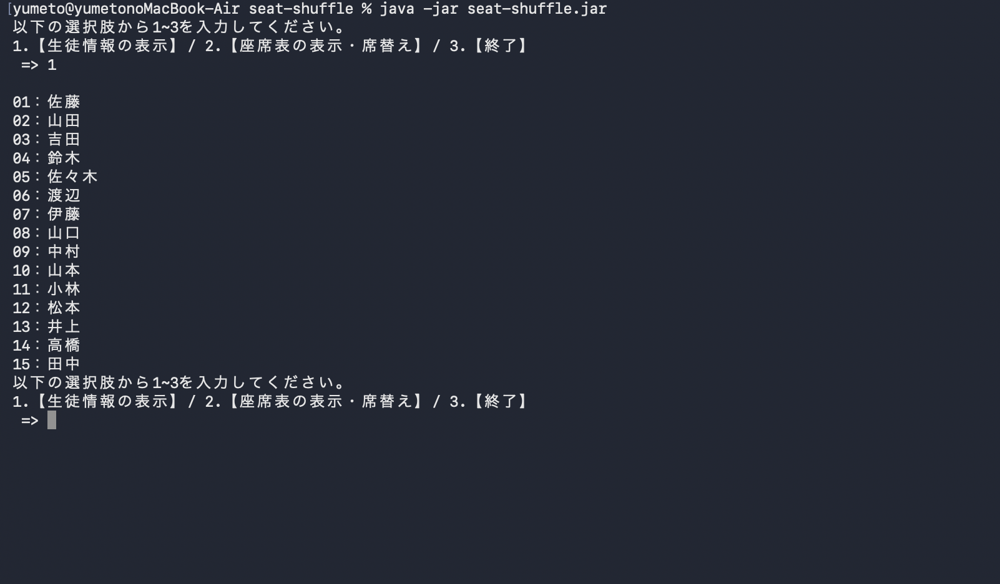
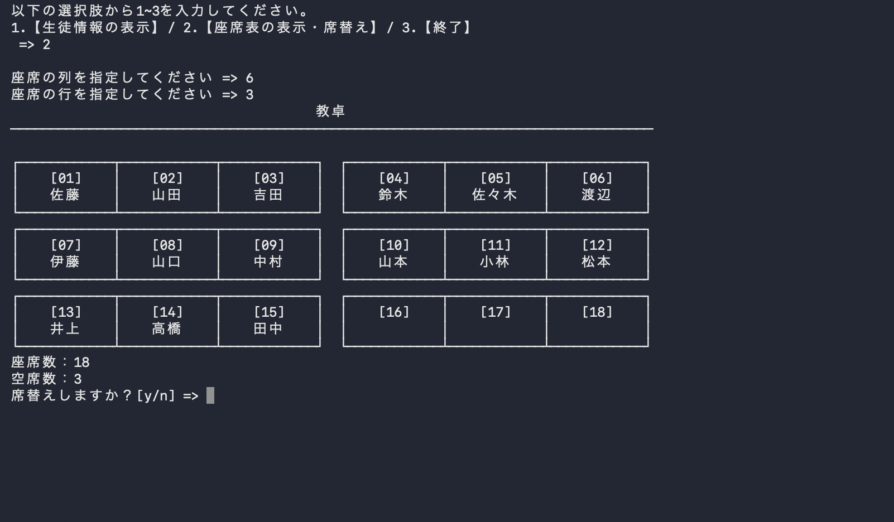
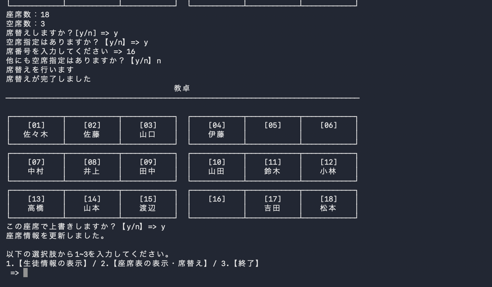

# Seat Shuffle — Javaコンソール席替えアプリ

Javaで制作した、**CSVの名簿を使って席替えを行うコンソールアプリ**です。
座席表を表示し、前回と同じ席を避けながら席替えできます。空席にしたい席番号を指定でき、結果を確認してからCSVに保存できます。

## 主な機能

- **生徒情報の表示**：`students.csv` から席番号と氏名を読み込み、一覧表示します。
- **座席表の表示**：指定した行数・列数をもとに、教卓や通路を含む座席表をコンソールに表示します。
- **ランダムな席替え**：`Collections.shuffle()` を使い、前回と同じ席になることを避けて配置します。
- **空席の自動調整**：登録済みの生徒数より座席数が多い場合、差分を空席として扱います。
- **空席の位置指定**：指定した席番号に生徒が座らないようにできます。
- **CSVへの保存**：席替え結果を確認後、保存を選択した場合だけ、席番号順で `students.csv` を上書きします。
- **シャッフル回数の制限**：条件に合う配置が見つからない場合に備え、最大1,000回で試行を終了します。

## 実行画面

### 1. 生徒情報の一覧表示

CSVファイルから生徒情報を読み込み、席番号と氏名を一覧表示します。



### 2. 席替え前の座席表

行数と列数を指定すると、教卓や通路を含む座席表を表示します。



### 3. 席替え後の座席表

前回と同じ席を避けてシャッフルします。
空席位置の指定にも対応し、結果をCSVに保存できます。



## 使用技術

| 項目 | 内容 |
| --- | --- |
| 言語 | Java 21 |
| 開発形式 | コンソールアプリケーション |
| データ保存 | CSV（UTF-8） |
| 主な標準ライブラリ | `Scanner`、`List`、`ArrayList`、`Collections`、`Files` |
| ビルド・パッケージ化 | `javac`, `jar`, `jpackage` |
| 配布形式 | Windows向けEXE |

外部ライブラリやデータベースは使用していません。

## 実行方法

### 1. Windows版（EXE）

[**最新版をダウンロード**](https://github.com/yumeto101-eng/seat-shuffle/releases/latest)

#### Windows向けEXE版について

Windows向けの実行ファイルを配布する場合は、`jpackage` で生成した **EXE・`app`・`runtime` を含むフォルダ一式**を使用します。EXE単体ではなく、配布フォルダ全体が必要です。

### 2. ソースコードから実行

#### 必要環境

- Java 21（JARを実行する場合）
- JDK 21（ソースコードからコンパイルする場合）
- Windows PowerShell または macOSのターミナル

`students.csv` はプログラムの**実行時のカレントディレクトリ**から読み込まれます。以下のコマンドは、Javaソースファイルと `students.csv` があるプロジェクトのフォルダ内で実行してください。

#### コンパイルして実行

```Windows（powershell）
New-Item -ItemType Directory -Path .\out -Force | Out-Null
javac -encoding UTF-8 --release 21 -d .\out MainSeatShuffle.java Student.java SeatMap.java Shuffle.java InOutCsv.java Register.java

jar cfe seat-shuffle.jar MainSeatShuffle -C out .
java -jar seat-shuffle.jar
```

```macOS（ターミナル）
mkdir -p out

javac -encoding UTF-8 --release 21 -d out MainSeatShuffle.java Student.java SeatMap.java Shuffle.java InOutCsv.java Register.java

jar cfe seat-shuffle.jar MainSeatShuffle -C out .

java -jar seat-shuffle.jar
```

JARを作成済みの場合は、プロジェクトのフォルダで `java -jar seat-shuffle.jar` を実行するだけで起動できます。

## 操作方法

1. メインメニューから「生徒情報の表示」または「座席表の表示・席替え」を選択します。

2. 席替えを行う場合は、座席の列数と行数を指定します。

3. 現在の座席表を確認し、席替えを実行するか選択します。

4. 空席がある場合は、必要に応じて空席にする席番号を指定します。

5. シャッフル後の座席表を確認します。

6. 保存を選択すると、結果が students.csv に上書きされます。

※ 数字は半角で入力してください。

## CSVデータについて

ファイル名は `students.csv`、文字コードはUTF-8です。1行目は見出し `id,name`、以降は席番号と氏名をカンマで区切ります。

```csv
id,name
1,佐藤
2,鈴木
3,高橋
4,田中
5,伊藤
6,渡辺
7,山本
8,中村
9,小林
10,
11,吉田
12,山田
13,佐々木
14,
15,山口
16,松本
17,
18,井上
```

このCSVは、一般的な苗字を使った**架空のサンプルデータ**です。`10`、`14`、`17` は名前を空欄にしています。

初期サンプルは **18席・生徒15人**です。まずは「列：6、行：3」で試すことをおすすめします。

**注意：** 席替え結果を保存すると `students.csv` が上書きされます。初期状態に戻したい場合は、あらかじめファイルをコピーしておいてください。

## クラス構成

| ファイル | 役割 |
| --- | --- |
| `MainSeatShuffle.java` | メインメニュー、入力受付、各処理の呼び出し |
| `Student.java` | 生徒の席番号・氏名の保持、氏名のチェック |
| `SeatMap.java` | 席番号と氏名を含む座席表の表示 |
| `Shuffle.java` | ランダムな席替え、空席指定、結果の保存確認 |
| `InOutCsv.java` | CSVファイルの読み込み・書き込み |
| `Register.java` | 生徒登録用の補助処理（現在のメインメニューからは未使用） |

## 制作で工夫した点・学んだこと

1. **役割ごとのクラス分割**：生徒データ、座席表示、席替え、CSV操作を分け、処理を整理しました。
2. **席替えの条件設定**：ランダムに番号を割り当てるだけでなく、前回と同じ席や指定した空席を避ける条件を加えました。
3. **座席数と生徒数の違いへの対応**：CSVの行数ではなく、名前が入力されている生徒数を数えて空席数を計算するように改善しました。
4. **ファイルへの保存**：CSVを読み込み、結果を席番号順に並べて保存することで、次回の席替えにもデータを引き継げるようにしました。
5. **コンソール上での見やすさ**：罫線を使って座席と通路を表し、席番号・氏名を見ながら操作できるようにしました。

## 現時点の制約・今後の改善

- 入力は半角数字を想定しています。数字以外の入力など、一部の不正な入力では例外が発生する場合があります。
- 空席に指定する番号の範囲・重複について、十分な入力チェックは実装していません。
- シャッフルは最大1,000回まで試しますが、条件を満たす配置が存在することや、必ず成功することを保証する方式ではありません。
- `students.csv` が存在しない場合の案内や自動作成は未実装です。
- 座席の列数が1の場合など、一部の配置では座席表の表示が崩れる可能性があります。

学習開始から約1か月の段階で習得した技術を組み合わせ、**基本機能を最後まで実装すること**を目標に制作しました。
